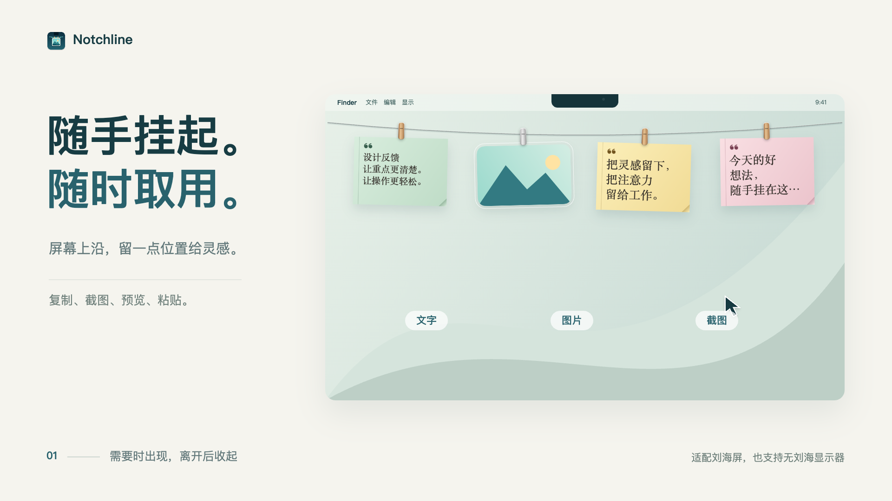
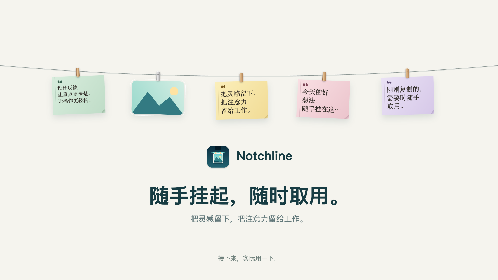
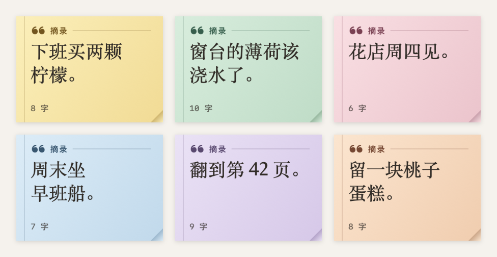
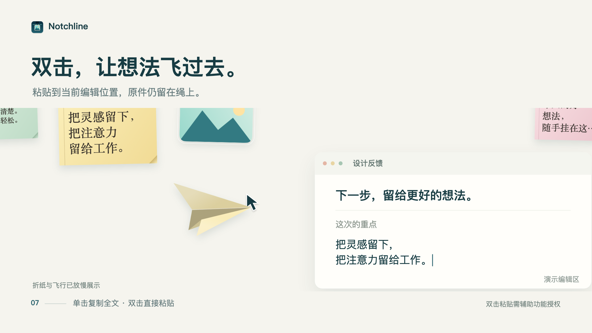

<div align="center">

# Notchline

### 把复制的灵感，挂在屏幕上沿。

A little shelf for screenshots, images, and words, right beneath your Mac’s notch.

**macOS 14+ · Native Swift / AppKit / SwiftUI · MIT**

[中文介绍](#中文介绍) · [English](#english) · [72 秒视频](https://github.com/erdoma5/Notchline/raw/refs/heads/main/docs/assets/notchline-showcase.mp4) · [构建指南](#从源码构建)

</div>



> Notchline 基于 [Alejandro Buján](https://github.com/alejandrobujan) 的 [Tendedero v1.7.0](https://github.com/alejandrobujan/tendedero/tree/v1.7.0) 修改。感谢原作者创造了这套轻巧的交互基础。本项目是独立衍生版本，使用自己的名称和图标，不代表上游项目，也未获其背书。[原始许可证](LICENSE)完整保留。

## 视频介绍

[](https://github.com/erdoma5/Notchline/raw/refs/heads/main/docs/assets/notchline-showcase.mp4)

**[下载观看完整视频 · 72 秒 · 1080p · 13 MB](https://github.com/erdoma5/Notchline/raw/refs/heads/main/docs/assets/notchline-showcase.mp4)**

视频与展示图为程序化产品演示，使用应用原生视觉素材，不是实机录屏。部分动作为展示而放慢，玻璃效果可能与真实桌面不同。视频展示「晾衣绳」主题；应用也提供「粒子浮现」。[素材说明](docs/MEDIA.md)

## 中文介绍

Notchline 是一个原生 macOS 菜单栏工具。复制一段文字、一张图片，或截一张图，就能把内容暂时挂在屏幕上沿，随手预览、复制和粘贴，不用在窗口之间来回翻找。

### 可以做什么

- **随手收集**：收集复制的文字、图片，以及截图文件夹中的新图片。文字变成彩色纸签，图片保留缩略图。
- **靠近刘海，轻轻展开**：刘海屏在刘海区域唤出；没有刘海的显示器，在菜单栏中间三分之一区域唤出。
- **单击复制，双击粘贴**：先聚焦目标输入框，再双击纸签或图片。文字粘贴有纸飞机反馈；图片需要目标编辑器支持。
- **两种外观**：温暖的「晾衣绳」与带光束、扫描和消散效果的「粒子浮现」，共用同一组内容和操作。
- **看清再使用**：悬停放大预览，按住查看 / 标记，力度点按 Quick Look。
- **轻松整理**：拖离取下，拖回归位，使用「放回」或在线条上按 ⌘Z 撤销。拖离手势保留原文件。
- **顺着系统习惯**：支持减少动态效果、降低透明度、多语言；macOS 26+ 使用原生 Liquid Glass，旧系统使用磨砂材质。

### 文字、图片，都能暂存



### 粘贴之后，一架纸飞机



### 开始使用

1. 按下方说明从源码构建，解压 `build/Notchline.app.zip`，将 `Notchline.app` 放进应用程序文件夹并打开。
2. 新安装默认开启「挂上复制的图片」和「挂上复制的文字」，可以在菜单栏中分别关闭。
3. 复制内容，将指针移到刘海或菜单栏中间区域。单击卡片复制内容。
4. 若要双击粘贴，在菜单栏的「双击粘贴权限」中前往 macOS 辅助功能设置，授权当前安装的 Notchline；随后先点入目标输入框，再双击卡片。

双击粘贴并不兼容所有应用或输入框；可识别的密码输入框会被排除。权限在升级后失效时，先用「在访达中显示此应用」确认安装位置，再在系统设置中移除旧条目并添加当前应用。

### 隐私与文件行为

- 内容保存在本机，不需要账户或云端服务。应用不包含内置内容上传功能；「检查更新」会在浏览器中打开本项目的 GitHub Releases。
- 复制的文字与图片默认会收集，并以**未加密的本地文件**存放在 `~/Library/Application Support/Notchline/`。不希望保存时，请关闭对应的收集选项。
- 应用会跳过带隐私 / 临时标记的剪贴板内容，但并非所有应用都会添加标记，**不能保证识别所有密码或敏感信息**。
- 拖离卡片会取下展示，保留原文件。主动清理、容量淘汰或「移到废纸篓」等操作可能把应用保存的文件移到废纸篓；请区分取下与删除。
- 辅助功能权限用于向目标应用发送粘贴操作。文件夹访问仅在使用对应功能、由 macOS 提示时授权。

### 从源码构建

运行要求：macOS 14 Sonoma 或更新版本，Apple Silicon 或 Intel Mac。

构建要求：Xcode 26+（或具备 macOS 26+ SDK 的兼容 Swift 工具链）。最低运行版本是 macOS 14，但编译原生玻璃接口需要较新的 SDK。没有第三方 Swift Package 依赖。

```sh
git clone https://github.com/erdoma5/Notchline.git
cd Notchline

# 运行测试与翻译检查
swift test --disable-sandbox
swift scripts/check-strings.swift

# 本地开发构建，允许 ad hoc 签名
bash scripts/build-app.sh debug
```

构建脚本生成同时支持 Apple Silicon 和 Intel 的 `build/Notchline.app.zip`。开发版不是 Apple 公证发行包；ad hoc 签名在更换构建后可能需要重新授权辅助功能。不要同时保留多份同名应用。

用于分发的 release 构建需要稳定的代码签名身份，**不要把证书、私钥或凭据提交到仓库**：

```sh
NOTCHLINE_SIGNING_IDENTITY="Your signing identity" bash scripts/build-app.sh release
bash scripts/package-dmg.sh
```

升级时退出旧版，在原安装目录选择替换。保留应用名称 `Notchline.app`、可执行文件 `Notchline` 和 bundle ID `local.notchline.personal`，以继续使用已有设置与内容。每次发布新安装包都要递增版本号与 build 号。详细行为见 [BEHAVIOR.md](docs/BEHAVIOR.md)。

## English

Notchline is a native macOS menu bar app that keeps copied text, images, and screenshots within reach at the top of your screen.

Move toward the notch to reveal your collection. Click a card to copy it, or focus an editor and double-click to paste. Choose a warm clothesline or a particle shelf; hover to preview, pull cards away to remove them from view, and put them back when needed.

**Notchline additions** include text clippings with persistent paper colors, passive hover previews, guarded double-click paste, paper-plane feedback, particle effects, and native glass on newer macOS versions. The app builds on the original capture and clothesline experience in Tendedero.

### Build and run

- Runtime: macOS 14+, Apple Silicon or Intel.
- Build: Xcode 26+ or a compatible toolchain with a macOS 26+ SDK. The app has no third-party Swift Package dependencies.
- Run `swift test --disable-sandbox` and `swift scripts/check-strings.swift`.
- Run `bash scripts/build-app.sh debug`, then unzip `build/Notchline.app.zip` and install the app.
- Release builds require a stable signing identity. Use `NOTCHLINE_SIGNING_IDENTITY="Your signing identity" bash scripts/build-app.sh release`, then `bash scripts/package-dmg.sh`.

Local signing is not Apple notarization. Keep the app name and bundle identifier unchanged when replacing an existing installation. Never commit signing credentials.

### Permissions and privacy

Clipboard image and text collection are enabled by default and can be disabled separately. Collected content is stored locally as **unencrypted files** under `~/Library/Application Support/Notchline/`. Private clipboard markers are respected when provided by the source app, but they are not a complete sensitive-data detector.

Accessibility permission is needed for double-click paste. Focus a receiving editor first; not every app accepts pasted images or exposes enough focus information. Identifiable secure text fields are excluded.

Pulling a card away preserves its source file. Cleanup, capacity limits, and explicit Trash commands can move app-owned saved files to the Trash. The app has no built-in content-upload service; Check for Updates opens this repository’s Releases page in your browser.

### Demo and credits

The [72-second showcase](https://github.com/erdoma5/Notchline/raw/refs/heads/main/docs/assets/notchline-showcase.mp4) and selected images are programmatic demonstrations using native app visuals, not desktop recordings. Some motion is slowed for clarity. See [media provenance](docs/MEDIA.md).

Notchline is an independent derivative of [Tendedero v1.7.0](https://github.com/alejandrobujan/tendedero/tree/v1.7.0) by [Alejandro Buján](https://github.com/alejandrobujan). It uses a different name and original icon, as required by the upstream license. It is not endorsed by or affiliated with Tendedero.

## License / 许可证

Source code is distributed under the **MIT License**. The original copyright notice and full upstream license, including its name and icon restrictions, are retained in [LICENSE](LICENSE). Notchline modifications are also provided under MIT. See [ACKNOWLEDGEMENTS.md](ACKNOWLEDGEMENTS.md).
